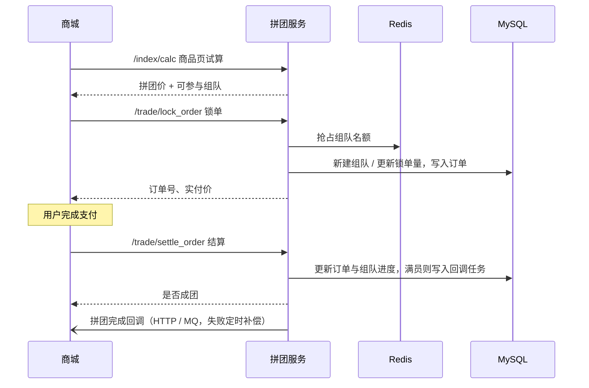

# groupbuy-market-plus 拼团营销服务

面向电商商城的**拼团营销中台**。商城负责商品、下单与支付；本服务负责拼团价格试算、组队、锁单、结算、退单、邀请返利，并在拼团完成或退单时通过 HTTP / MQ 回调通知商城。

## 功能概览

| 能力 | 说明 |
|---|---|
| 商品页试算 | 按活动配置计算原价、优惠金额、实付价，支持直减 / 满减 / 折扣 / 满折扣 / N 元购 5 种优惠，支持人群标签限定 |
| 拼团组队 | 团长开团、团员参团，Redis 无锁抢占组队名额，团长额外 95 折 |
| 锁单 | 用户下单时占用组队名额，同一外部交易单号幂等 |
| 结算 | 商城支付成功后结算，凑满人数即拼团完成并触发回调 |
| 退单 | 区分「未成团未支付 / 未成团已支付 / 已成团已支付」三种场景，团长退单自动转移团长身份并通知新团长 |
| 超时处理 | 定时扫描超时未成团的组队自动退单，同时失效对应邀请码 |
| 邀请返利 | 为组队生成唯一邀请码，被邀请人凭码参团，成团回调中携带邀请人列表 |
| 回调通知 | HTTP 或 RabbitMQ 两种方式，回调任务落库，失败定时补偿，最多重试 5 次 |
| 动态配置 | 降级开关、按用户切量、来源渠道黑名单，通过 Redis 发布订阅实时生效，无需重启 |

## 技术栈

| 类别 | 选型 |
|---|---|
| 语言 / 框架 | Java 17、Spring Boot 2.7.12 |
| 持久层 | MyBatis 2.1.4、MySQL 8 |
| 缓存 / 分布式锁 | Redis（Redisson 3.26.0） |
| 消息队列 | RabbitMQ（spring-boot-starter-amqp） |
| 其他 | OkHttp（HTTP 回调）、Guava、Fastjson2、Lombok |

## 工程结构

项目按 DDD 分层拆为 6 个 Maven 模块：

```
groupbuy-market-plus
├── groupbuy-market-plus-api             对外接口定义、请求 / 响应 DTO
├── groupbuy-market-plus-app             启动类、配置类、MyBatis 映射文件、测试
├── groupbuy-market-plus-domain          领域层：activity（试算）/ tag（人群标签）/ trade（交易）
├── groupbuy-market-plus-infrastructure  仓储实现、DAO、Redis / MQ / HTTP 适配、动态配置
├── groupbuy-market-plus-trigger         入口层：HTTP 接口、定时任务、MQ 监听
└── groupbuy-market-plus-types           通用组件：规则树、责任链、注解、枚举、异常
```

### 流程编排

`types` 模块提供两套通用框架，业务流程在其上组装：

- **规则树**（`design/framework/tree`）：支持多线程预加载数据
  - 试算：根节点 → 开关节点（降级 / 切量）→ 标签节点（人群标签）→ 营销节点（优惠计算）→ 尾节点
  - 退单：根节点 → 重复退单校验 → 用户校验 → 退单执行（按场景选择策略）→ 尾节点
- **责任链**（`design/framework/link`）
  - 锁单：活动校验 → 用户参与次数 → 邀请码 → 组队名额抢占
  - 结算：来源渠道黑名单 → 订单状态 → 支付时间
  - 邀请：邀请人资格 → 组队状态

### 拼团生命周期



## 快速开始

### 1. 环境要求

| 依赖 | 版本 / 说明 |
|---|---|
| JDK | **17**。项目使用的 Lombok 1.18.26 不兼容 JDK 21，在 JDK 21 下编译会报 `NoSuchFieldError: JCTree$JCImport` |
| Maven | 3.6+ |
| MySQL | 8.x，库名 `groupbuy-market-plus` |
| Redis | 用于名额抢占、分布式锁、动态配置 |
| RabbitMQ | 用于 MQ 回调与退单消息 |

### 2. 数据库

> 仓库暂未提供建表脚本，需要自行准备。

涉及的数据表：

| 表 | 用途 |
|---|---|
| `activity` | 拼团活动配置（目标人数、有效时长、参与次数上限、人群标签等） |
| `discount` | 优惠配置（优惠类型、营销计划 ZJ/MJ/ZK/MZK/N、计算表达式、人群标签） |
| `sku` | 商品信息 |
| `sc_sku_activity` | 来源、渠道、商品与活动的关联 |
| `crowd_tags` / `crowd_tags_user` / `crowd_tags_job` | 人群标签、标签用户、标签任务 |
| `group_buy_team` | 拼团组队（目标量、锁单量、完成量、状态、有效期、回调配置） |
| `group_buy_team_order` | 拼团订单（外部交易单号、价格、状态、邀请人） |
| `notify_task` | 回调任务（按 `task_id` 唯一标识，建议为其建立唯一索引） |
| `invite` | 邀请码 |

### 3. 配置

编辑 `groupbuy-market-plus-app/src/main/resources/application-dev.yml`，填写以下连接信息（默认留空）：

```yaml
spring:
  datasource:
    username: <数据库用户名>
    password: <数据库密码>
    url: jdbc:mysql://localhost:3306/groupbuy-market-plus?...
  rabbitmq:
    addresses: <RabbitMQ 地址>
    port: <端口>
    username: <用户名>
    password: <密码>

redis:
  sdk:
    config:
      host: <Redis 地址>
      port: <端口>
```

默认激活 `dev` 环境，服务端口 `8091`。

### 4. 编译与启动

```bash
# 编译打包
mvn clean package -DskipTests

# 启动
java -jar groupbuy-market-plus-app/target/groupbuy-market-plus-app.jar
```

也可以在 IDE 中直接运行 `groupbuy-market-plus-app` 模块的 `groupbuy.market.plus.Application`。

## 接口说明

所有接口统一返回格式：

```json
{ "code": "0000", "info": "成功", "data": { } }
```

| 方法 | 路径 | 说明 |
|---|---|---|
| POST | `/index/calc` | 商品页试算：价格、可参与组队、统计信息 |
| POST | `/trade/lock_order` | 锁单 |
| POST | `/trade/settle_order` | 结算 |
| POST | `/trade/refund_order` | 退单 |
| POST | `/trade/team_progress/{teamId}` | 查询组队进度 |
| POST | `/trade/invite` | 生成邀请码 |
| POST | `/dcc/config/update?key=&value=` | 推送动态配置 |

### 商品页试算 `/index/calc`

```json
{
  "userId": "user01",
  "goodsId": "9890001",
  "source": "s01",
  "channel": "c01"
}
```

### 锁单 `/trade/lock_order`

```json
{
  "userId": "user01",
  "teamId": "",
  "activityId": 100123,
  "goodsId": "9890001",
  "source": "s01",
  "channel": "c01",
  "inviteId": "",
  "outTradeNo": "商城侧订单号",
  "notifyConfig": {
    "notifyType": 1,
    "notifyUrl": "http://商城地址/group_buy_notify",
    "headerRefundNotifyUrl": "http://商城地址/header_refund_notify"
  }
}
```

- `teamId` 为空表示开团（成为团长），不为空表示加入该组队。
- `inviteId` 为邀请码，凭码参团时填写。
- `notifyType`：`1` HTTP（填 `notifyUrl`、`headerRefundNotifyUrl`），`2` MQ（填 `notifyMQ`、`refundNotifyMQ`、`headerRefundNotifyMQ`）。

### 结算 `/trade/settle_order`

```json
{
  "userId": "user01",
  "outTradeNo": "商城侧订单号",
  "outTradeNoPayTime": "2026-10-27T10:00:00.000+08:00",
  "source": "s01",
  "channel": "c01"
}
```

响应中 `isComplete` 为 `true` 表示本次结算使拼团完成。

### 退单 `/trade/refund_order`

```json
{
  "userId": "user01",
  "outTradeNo": "商城侧订单号",
  "source": "s01",
  "channel": "c01"
}
```

### 生成邀请码 `/trade/invite`

```json
{ "userId": "user01", "teamId": "TEAM12345678" }
```

### 动态配置 `/dcc/config/update`

| key | 默认值 | 说明 |
|---|---|---|
| `downgradeSwitch` | `0` | 降级开关，`1` 开启后试算直接拦截 |
| `cutRange` | `100` | 切量比例（0–100），按用户 ID 哈希取模判断是否放行 |
| `scBlack` | `s02,c02` | 来源 / 渠道黑名单，逗号分隔，命中则禁止结算 |

示例：`POST /dcc/config/update?key=scBlack&value=s02,c02,c03`

### 回调内容

拼团完成时向商城回调：

```json
{
  "teamId": "TEAM12345678",
  "outTradeNoList": ["订单号1", "订单号2", "订单号3"],
  "inviteUserIdList": ["邀请人ID"]
}
```

商城侧需对回调做幂等处理：极端情况下同一回调可能被发送多次。

## 定时任务

| 任务 | 频率 | 说明 |
|---|---|---|
| `TeamSuccessNotifyJob` | 每 10 秒 | 补偿发送拼团完成回调 |
| `OrderRefundNotifyJob` | 每 10 秒 | 补偿发送退单回调 |
| `HeaderRefundNotifyJob` | 每 10 秒 | 补偿发送团长退单补偿回调 |
| `TeamTimeOutRefundJob` | 每 15 分钟 | 超时未成团的组队自动退单，并失效邀请码 |

多实例部署时，各任务通过 Redis 分布式锁保证同一时刻只有一个实例执行。

## 测试

测试代码位于 `groupbuy-market-plus-app/src/test/java`：

| 目录 | 类型 | 说明 |
|---|---|---|
| `test/unit` | 单元测试 | 基于 Mockito，不依赖 MySQL / Redis / RabbitMQ，可直接运行 |
| `test/domain` | 集成测试 | 启动 Spring 上下文，需要先准备好外部服务与测试数据 |

> `groupbuy-market-plus-app/pom.xml` 中 surefire 配置了 `skipTests=true`，`mvn test` 默认不会执行测试，请在 IDE 中运行测试类。

## 分支与提交规范

- 主干分支：`master`
- 功能分支：`开始日期-功能英文名`，例如 `2025-10-16-refund-order`、`2026-10-27-fix-p0-bugs`，开发完成后合并回 `master`
- 提交信息：`类型: 中文描述`，例如 `feat: 邀请返利`、`fix: 修正拼团超时退单定时任务的执行频率`
